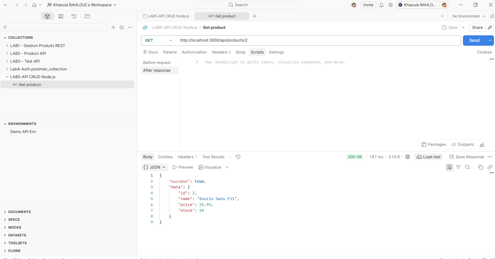
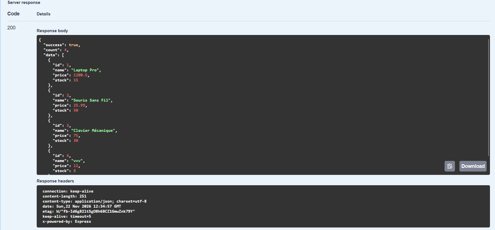
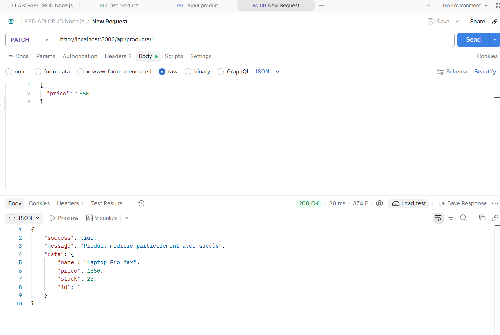
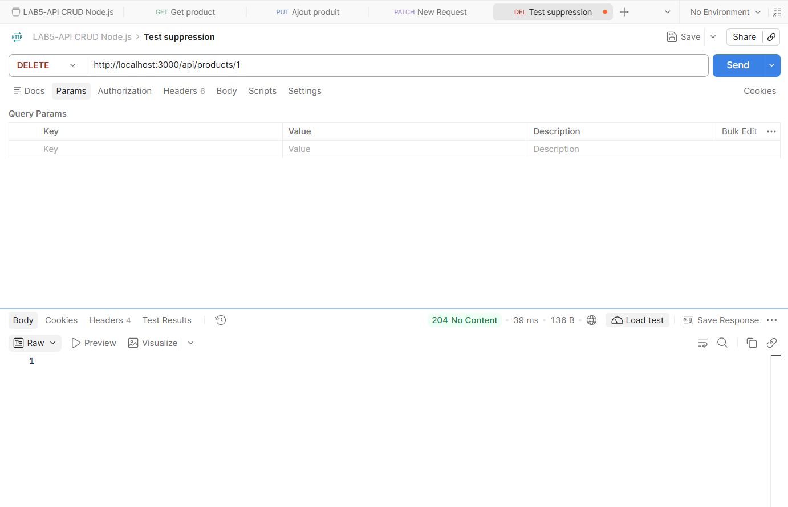

# Lab 5 – API REST de gestion de produits (Node.js / Express)

L'objectif du LAB 5 consiste à construire une API REST CRUD complète pour la gestion de produits en utilisant Node.js et Express.js. L'objectif est de produire une application exécutable, modulaire et documentée. 

## Prérequis

- Node.js version 18 ou supérieure (LTS recommandée).
- Un éditeur de code (VS Code, WebStorm).
- Connaissances de base en JavaScript (ES6+).

## Installation et lancement

Après l'initialisation du projet, on lance avec les commandes suivantes :

```bash
npm install
npm run dev
```

Le serveur démarre sur http://localhost:3000


## Architecture

- `src/routes` : Définissent les URLs et les verbes HTTP.
- `src/controllers` : Gèrent la requête HTTP et la réponse.
- `src/services` : Contiennent la logique métier.
- `src/repositories` : Gèrent l'accès aux données (en mémoire).
- `src/models`: Définissent la structure des objets.
- `src/middlewares` : Interceptent les requêtes et les réponses pour assurer la validation des données, l'authentification, la journalisation et la gestion centralisée des erreurs.
- `swagger.js` : configuration de la documentation OpenAPI


## Endpoints

| Méthode | URL | Description |
|---|---|---|
| GET | /api/products | Lister les produits |
| GET | /api/products/:id | Récupérer un produit |
| POST | /api/products | Créer un produit |
| PUT | /api/products/:id | Modifier un produit |
| DELETE | /api/products/:id | Supprimer un produit |

## Tests avec Postman

La collection est dans le dossier `screenshots`.

### Lister les produits



### Créer un produit



### Modifier un produit



### Supprimer un produit



## Validation et gestion des erreurs

La validation des entrées est faite avec express-validator, et les erreurs sont gérées
de façon centralisée.


## Documentation Swagger

Disponible sur http://localhost:3000/api-docs

